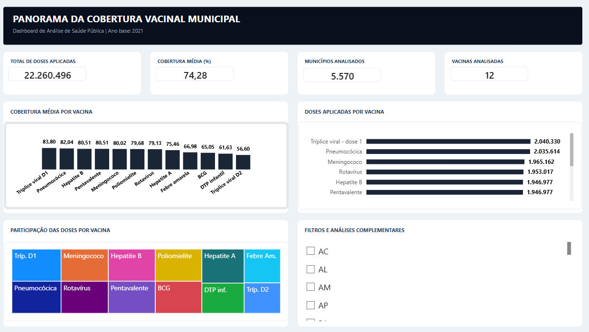
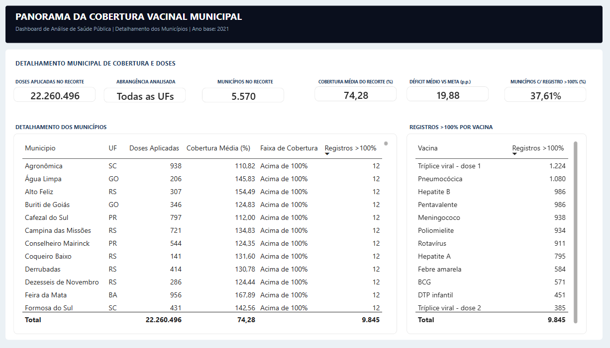

# Cobertura vacinal municipal no Brasil — 2021

Projeto individual desenvolvido como conclusão do curso de Data Analytics da Digital College, utilizando Power BI, Power Query e DAX.

O painel explora a cobertura vacinal e as doses registradas nos municípios brasileiros em 2021, com visão geral por vacina e detalhamento municipal.

## Visão geral do painel

## Detalhamento dos municípios

As imagens são versões estáticas. Os filtros e demais interações estão disponíveis no arquivo do Power BI.

## Objetivo

Organizar os dados de vacinação em um relatório que permita explorar:

- Cobertura média por vacina.
- Distribuição das doses aplicadas.
- Resultados por UF e município.
- Registros de cobertura acima de 100%.

## Dados analisados

O recorte contém 66.840 registros: 5.570 municípios × 12 categorias de vacinas, no ano de 2021.

| Indicador | Resultado sem filtros |
| --- | ---: |
| Doses aplicadas | 22.260.496 |
| Cobertura média | 74,28% |
| Municípios analisados | 5.570 |
| Vacinas analisadas | 12 |
| Registros com cobertura acima de 100% | 9.845 |
| Municípios com pelo menos um registro acima de 100% | 37,61% |

### Como interpretar os indicadores

**Doses aplicadas:** soma das doses registradas na base. Não representa a quantidade de pessoas vacinadas, pois uma pessoa pode receber várias doses.

**Cobertura média:** média simples dos percentuais registrados por município e vacina. O resultado de 74,28% não significa que 74,28% da população brasileira foi vacinada.

**Registros acima de 100%:** combinações de município e vacina cujo percentual informado supera 100%. Esses valores foram preservados para análise e não representam, isoladamente, erro comprovado.

**Municípios com registro acima de 100%:** proporção dos municípios que apresentam pelo menos uma vacina nessa condição. É um indicador diferente da quantidade de registros acima de 100%.

## Desenvolvimento

O projeto reúne:

- Importação dos arquivos CSV e tratamento dos tipos de dados no Power Query.
- Organização das tabelas de vacinação, municípios, UFs e vacinas.
- Modelagem dos relacionamentos.
- Criação de medidas DAX para os indicadores.
- Construção de duas páginas com gráficos, tabelas e filtros.
- Conferência dos totais e das contagens do recorte.

## Organização dos arquivos

| Pasta | Conteúdo |
| --- | --- |
| Dados | Arquivos CSV utilizados no desenvolvimento |
| Imagens | Capturas das duas páginas do painel |
| PowerBI | Relatório interativo em formato PBIX |
| README.md | Apresentação e orientações do projeto |

A base `imunizacao_2021_com_municipios.csv` inclui os nomes dos municípios, UFs e regiões e é a fonte da consulta FatoVacinacao na versão preparada para este repositório.

O arquivo `imunizacao_2021_power_bi.csv` contém o recorte sem essas colunas descritivas e foi mantido como material do desenvolvimento. Os dois arquivos representam o mesmo recorte e não devem ser somados entre si.

## Como abrir o projeto

1. Na página principal do repositório, clique em **Code → Download ZIP**.
2. Extraia o arquivo ZIP no computador.
3. Abra a pasta PowerBI e o arquivo PBIX no Power BI Desktop.
4. Para atualizar os dados, entre em **Transformar dados**.
5. Na consulta FatoVacinacao, ajuste a etapa Fonte para o arquivo `Dados/imunizacao_2021_com_municipios.csv` da pasta extraída.
6. Mantenha a codificação UTF-8 e o delimitador vírgula.
7. Clique em **Fechar e Aplicar**.

O caminho da fonte é local e precisa ser ajustado em outro computador. DimVacina e DimMunicipio utilizam FatoVacinacao como referência; DimUF utiliza DimMunicipio.

## Fonte dos dados

Dados do Ministério da Saúde/DATASUS, disponibilizados pela Base dos Dados.

- [Base dos Dados — Sistema de Imunizações, tabela municipal](https://basedosdados.org/dataset/e4f44946-b89f-4733-93e8-26b3ef0ab778?table=607df2c8-f043-4e55-a629-de8bcc083deb)
- Ano analisado: 2021.

## Limites da análise

Este é um projeto de estudo com recorte de um único ano. Ele não permite avaliar evolução temporal nem estabelecer causas para diferenças entre municípios.

A média simples atribui o mesmo peso a cada registro de município e vacina. Ela não é uma média ponderada pela população.

Percentuais acima de 100% precisam ser interpretados com atenção às características do registro e do denominador utilizado. O painel, sozinho, não identifica a causa desses resultados.

## Visualização e exportação

As capturas de tela foram utilizadas para preservar o alinhamento apresentado no Power BI Desktop.

A exportação para PDF apresentou desalinhamento entre o fundo e os visuais e não foi incluída nesta publicação.

## Autoria

**Colnilo (Nilo) Lima**

Projeto desenvolvido durante minha formação em Data Analytics e minha transição para Análise de Dados e BI.

- [Perfil no GitHub](https://github.com/nilolimasol-bit)
- [Perfil no LinkedIn](https://www.linkedin.com/in/colnilo-lima-76b88595/)
